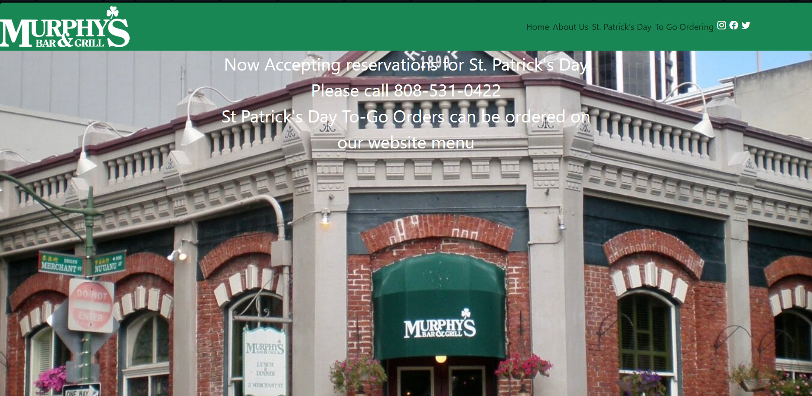

<h2 align="center">Learning Bootstrap</h2>

 
  

I believe UI frameworks are worth learning, even though they can feel as complicated as a new programming language at first. After using Bootstrap 5 on a restaurant page for Murphy's as a practice assignment, I found that it makes many small layout decisions for me, so I spend less time on layout and more time on the rest of the page. Raw HTML and CSS can give you full control, but even a simple navigation bar needs decisions about alignment, spacing, and layout. Bootstrap has already made most of those decisions, which makes it easy to add a few classes, check the layout, and see whether it works.

<h2 align="center">What I Enjoyed</h2>

The navbar was my favorite part. Each class in my navbar does one clear job: `bg-success` gives the bar its green background, `justify-content-start` and `justify-content-end` place the logo (an image) on the left and the links on the right, and `p-1` adds consistent padding. Reading the classes feels like reading a description of the design. I also liked the buttons and dropdowns, since a button only needs `btn btn-primary` to look good, and a dropdown works by adding `data-bs-toggle="dropdown"` without extra JavaScript. The `container` class and the margin classes like `mt-4` were very useful for centering content and consistent spacing across the whole site or within certain areas.

<h2 align="center">Takeaway</h2>

Overall, I find Bootstrap to be a little frustrating and very useful at the same time. It helps me build layouts quickly, consistently, and responsively. However, it takes time to learn and has a fairly generic default look on most pages, although it can be customized.

**AI Disclaimer: AI used for spelling and grammar checks. Thoughts, Ideas, Writing, are all the work of the Author**
